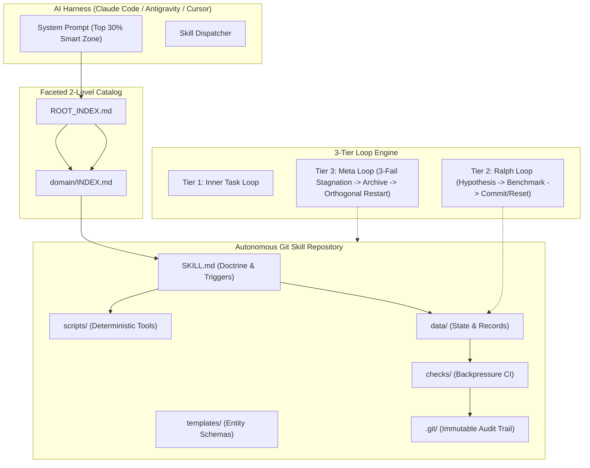

# Skill-First & Loop Engine

[](LICENSE)
[](https://www.python.org/)
[](https://git-scm.com/)
[](#why-git-based-skills-beat-rag)

> **Git-native agent memory and multi-tier autonomous loop engine for AI harnesses.**  
> Replaces brittle RAG vector databases with version-controlled, executable Git skill repositories.

[English](README.md) | [Русский](README.ru.md) | [中文](README.zh.md)

---

## Origin and Theoretical Grounding

This project implements the architecture presented by **Konstantin Krestnikov** in his landmark keynote:  
**["Git-based skills: The new memory of AI agents. My experience"](https://www.youtube.com/watch?v=a-NIeMB-Hj8)**.

Instead of constructing massive multi-agent graph scaffoldings (LangGraph, AutoGen) that degrade under production load, the system pairs an AI **Harness** (an agent equipped only with basic OS-level primitives: file read/write, bash, grep, and subagent invocation) with autonomous **Git-based skills**.

---

## Why Git-Based Skills Beat Classical RAG

| Dimension | Classical RAG (Vector DB) | Skill-First Architecture (Git Repositories) |
| :--- | :--- | :--- |
| **Retrieval Mode** | Stochastic (cosine similarity) | Deterministic (file trees, `grep`, structured schemas) |
| **Token Economy** | Massive context dumps on every turn | Two-stroke loading: 1-line trigger -> full markdown on activation |
| **History & Provenance** | None; static opaque chunks | Immutable commit logs (`git log`, blame, diffs) |
| **Execution** | Passive text; model parses everything | Executable scripts (`scripts/`) lift heavy mechanical compute |
| **State Validation** | Hallucinations go unchecked | Backpressure validation (`checks/`) blocks invalid commits |
| **Multi-Agent Sync** | Complex database coordination | Git synchronization with automated merge-conflict resolution |

---

## Core Architecture



---

## The 5 Operational Rules

### Rule 1. Skill Anatomy
Every skill is an autonomous Git repository:
- `SKILL.md`: Frontmatter trigger passport + on-demand operational doctrine.
- `scripts/`: Local deterministic utilities (Python / Bash) handling data pipelines without model token spend.
- `templates/` & `data/`: Rigid schemas and working state files queried via selective tools (`grep`, `find`).
- `checks/`: Backpressure scripts validating schema, invariants, and syntax before any commit.

### Rule 2. Strict Git Protocol & Backpressure
Every stateful skill interaction follows a 4-phase transaction:
1. **Ingress**: `git pull` or `git status` check. Auto-resolves non-conflicting merges.
2. **Execution**: targeted diffs on local state.
3. **Backpressure**: deterministic scripts in `checks/` run validation. Exit code != 0 blocks completion.
4. **Egress**: atomic `git add`, semantic commit message, and `git push`.

### Rule 3. Automated Curation & Evolution
- **5-Step Trigger**: any task requiring >5 consecutive tool calls is scaffolded as a new skill draft.
- **Continuous Calibration**: human feedback directly updates rules in `SKILL.md` so errors never repeat.
- **Weekly Curator**: consolidates overlapping skills; compresses frontmatters for skills idle >30 days; moves skills idle >90 days to `archive/`.

### Rule 4. Context Smart Zone & Loop Engineering
- **Top 30% Smart Zone**: context usage is kept within the first 30% of the window to maintain peak reasoning.
- **Ralph Loop**: multi-hour optimization loop running on clean restarts. Maintains `STATE.md`, tests 1 hypothesis at a time, commits on metric gain, runs `git reset --hard HEAD` on regression.
- **Meta Loop**: triggered after 3 consecutive failures. Archives previous attempts, resets workspace to baseline, and explores an orthogonal solution vector.

### Rule 5. Faceted Catalog & Two-Stroke Navigation
- Scales catalog past 50 skills by enforcing a strict 2-level hierarchy (`domain/skill`).
- Stroke 1: read `ROOT_INDEX.md` domain overview -> open target domain `INDEX.md`.
- Stroke 2: open target `SKILL.md` directly. Fast fallback: `grep -rn "keyword" */INDEX.md`.

---

## Repository Contents

```text
skill-first-engine/
|-- SKILL.md                 # Canonical English skill definition
|-- SKILL.ru.md              # Russian skill definition
|-- SKILL.zh.md              # Chinese skill definition
|-- scripts/
|   |-- build_index.py       # Faceted catalog builder & 2-level index generator
|   |-- git_skill_sync.py    # Transactional Git sync & backpressure controller
|   |-- curate_skills.py     # Memory hygiene auditor (pruning & consolidation)
|   |-- eval_harness.py      # Diagnostic fast-benchmark (harness-bench-fast & agentskills.io)
|   `-- loop_runner.py       # AutoResearch / Ralph Loop & Meta Loop controller
|-- templates/
|   |-- SKILL_TEMPLATE.md    # Scaffolds for new skills (EN / RU / ZH)
|   |-- STATE_TEMPLATE.md    # Ralph Loop state files (EN / RU / ZH)
|   `-- CHECK_TEMPLATE.py    # Backpressure check script template
|-- checks/
|   `-- validate_skill.py    # Backpressure validator for skill anatomy
|-- references/
|   `-- krestnikov_method.md # Theoretical breakdown of Konstantin Krestnikov's method (EN / RU / ZH)
|-- LICENSE                  # MIT License
`-- README.md                # Documentation (with RU / ZH variants)
```

---

## Quickstart

### 1. Validate a Skill Directory
```bash
python checks/validate_skill.py path/to/skill
```

### 2. Run Transactional Git Sync (Ingress -> Backpressure -> Egress)
```bash
python scripts/git_skill_sync.py --skill-dir path/to/skill --action full -m "feat(data): update entities"
```

### 3. Generate Faceted 2-Level Catalog
```bash
# Preview classification plan
python scripts/build_index.py /path/to/skills --classify

# Generate ROOT_INDEX.md and domain INDEX.md files
python scripts/build_index.py /path/to/skills --index

# Migrate flat directory layout into 6 domains
python scripts/build_index.py /path/to/skills --migrate --index
```

### 4. Run Autonomous Ralph Loop Iteration
```bash
python scripts/loop_runner.py \
  --work-dir /path/to/project \
  --hypothesis "Add index to lookup column" \
  --test-cmd "pytest tests/benchmarks" \
  --new-metric "142 ops/sec" \
  --direction higher
```

### 5. Run Fast Diagnostic Benchmark (Harness-Bench-Fast)
```bash
# Benchmark single skill or entire repository
python scripts/eval_harness.py path/to/skills
```

---

## Video Keynote Timestamps

- [[04:19]](https://www.youtube.com/watch?v=a-NIeMB-Hj8&t=259) Collapse of multi-agent graphs & death of complex scaffolding.
- [[08:11]](https://www.youtube.com/watch?v=a-NIeMB-Hj8&t=491) The Harness concept: minimum set of system OS tools.
- [[10:22]](https://www.youtube.com/watch?v=a-NIeMB-Hj8&t=622) Context saturation: 30-40 tools limit.
- [[21:29]](https://www.youtube.com/watch?v=a-NIeMB-Hj8&t=1289) Two-stage loading: lightweight prompt trigger vs on-demand doctrine.
- [[24:20]](https://www.youtube.com/watch?v=a-NIeMB-Hj8&t=1460) Skill + Data + Git = Autonomous agent memory.
- [[27:06]](https://www.youtube.com/watch?v=a-NIeMB-Hj8&t=1626) Backpressure validation: automated constraints.
- [[40:36]](https://www.youtube.com/watch?v=a-NIeMB-Hj8&t=2436) Self-improvement, the 5-step rule, and skill curation.
- [[45:01]](https://www.youtube.com/watch?v=a-NIeMB-Hj8&t=2701) The 30% Smart Zone and Ralph Loop mechanics.
- [[45:32]](https://www.youtube.com/watch?v=a-NIeMB-Hj8&t=2732) Karpathy collapse phenomenon and Meta Loop restarts.

---

## License

MIT License. Copyright (c) 2026 MakeHorizont.
