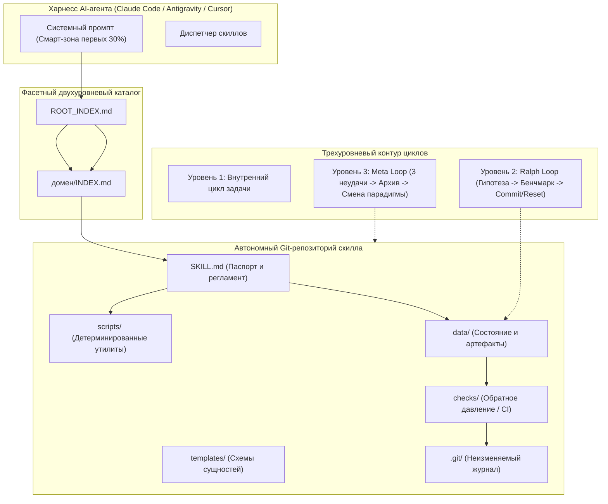

# Skill-First & Loop Engine (Архитектура памяти на базе Git-скиллов)

[](LICENSE)
[](https://www.python.org/)
[](https://git-scm.com/)
[](#почему-git-скиллы-эффективнее-классического-rag)

> **Долгосрочная память AI-агентов на базе Git-репозиториев и трехуровневый циклический контур исполнения (Loop Engine).**  
> Заменяет тяжелые векторные базы данных (RAG) версионируемой, детерминированной файловой средой с контролем обратного давления.

[English](README.md) | [Русский](README.ru.md) | [中文](README.zh.md)

---

## Происхождение и методологический базис

Проект реализует инженерную архитектуру из доклада **Константина Крестникова**:  
**["Скиллы на базе git - новая память AI-агентов. Мой опыт"](https://www.youtube.com/watch?v=a-NIeMB-Hj8)**.

Вместо построения громоздких мультиагентных графов (LangGraph, AutoGen), которые теряют устойчивость под нагрузкой, используется связка универсального **Харнесса** (агент с минимальным набором OS-инструментов: чтение/запись файлов, bash, grep, запуск субагентов) и **автономных Git-скиллов**.

---

## Почему Git-скиллы эффективнее классического RAG

| Параметр | Классический RAG (Векторные базы) | Архитектура Skill-First (Git-репозитории) |
| :--- | :--- | :--- |
| **Принцип поиска** | Стохастический (косинусная близость векторов) | Детерминированный (структура папок, `grep`, шаблоны) |
| **Экономия контекста** | Массивный сброс текста в каждый запрос | Двухэтапная загрузка: 1 строка в индексе -> полное чтение только при вызове |
| **История и аудит** | Отсутствует; черные ящики эмбеддингов | Неизменяемый журнал коммитов (`git log`, diff, blame) |
| **Исполняемость** | Пассивный текст; модель тратит токены на рутину | Локальные скрипты (`scripts/`) берут на себя механические вычисления |
| **Защита от галлюцинаций** | Не контролируется на уровне данных | Обратное давление (`checks/` / CI) блокирует ошибочные коммиты |
| **Мультиагентность** | Сложная координация через базу данных | Децентрализованная синхронизация через Git и слияние веток |

---

## Архитектура системы



---

## 5 фундаментальных правил системы

### Правило 1. Анатомия скилла
Каждый скилл представляет собой изолированный Git-репозиторий:
- `SKILL.md`: YAML-паспорт (1-2 строки для индекса) и полный рабочий регламент.
- `scripts/`: локальные детерминированные скрипты (Python/Bash) для механической обработки без траты токенов модели.
- `templates/` и `data/`: строгие схемы данных и рабочие сущности, считываемые точечно (`grep`, `find`).
- `checks/`: обязательные валидаторы целостности и схемы данных (Backpressure).

### Правило 2. Жесткий Git-протокол и обратное давление
Каждая операция изменения состояния проходит через 4 фазы транзакции:
1. **Вход (Ingress)**: `git pull` или проверка `git status`. Разрешение бесконфликтных слияний.
2. **Исполнение**: внесение точечных правок в данные или код.
3. **Обратное давление (Backpressure)**: запуск скриптов из `checks/`. При ошибке коммит строго заблокирован.
4. **Выход (Egress)**: атомарный `git add`, осмысленное сообщение коммита и `git push`.

### Правило 3. Автоматическое создание и курирование
- **Правило 5 шагов**: если задача потребовала более 5 вызовов инструментов для поиска конвейера, формируется черновик нового скилла.
- **Непрерывная калибровка**: замечания и исправления пользователя вносятся прямо в `SKILL.md`, исключая повторение ошибок.
- **Еженедельный куратор**: объединение дубликатов; сжатие описания для скиллов без вызовов >30 дней; перенос в `archive/` для скиллов без вызовов >90 дней.

### Правило 4. Управление контекстом, смарт-зона и петли управления
- **Смарт-зона (первые 30% окна)**: предотвращение деградации модели за счет удержания контекста чистым.
- **Внешний цикл (Ralph Loop)**: ведение `STATE.md` на диске, проверка ровно одной гипотезы за шаг, авто-коммит при росте метрики или мгновенный откат `git reset --hard HEAD` при регрессии.
- **Мета-цикл (Meta Loop / Анти-схлапывание)**: при 3 последовательных неудачах все наработки консервируются в `archive/attempt_N/`, рабочая папка сбрасывается к базовому состоянию, и проектирование начинается с нуля по ортогональному пути.

### Правило 5. Фасетный индекс и двухтактная навигация
- Каталог свыше 50 скиллов организуется строго в 2 уровня: `домен/скилл`.
- Такт 1: выбор домена по карте `ROOT_INDEX.md` и чтение локального `INDEX.md` домена (1 файловый запрос).
- Такт 2: прямое открытие целевого `SKILL.md`. Фолбэк: системный `grep -rn "ключевое_слово" */INDEX.md`.

---

## Состав репозитория

```text
skill-first-engine/
|-- SKILL.md                 # Канонический паспорт скилла (на английском)
|-- SKILL.ru.md              # Паспорт скилла на русском языке
|-- SKILL.zh.md              # Паспорт скилла на китайском языке
|-- scripts/
|   |-- build_index.py       # Построитель фасетного каталога и генератор INDEX.md
|   |-- git_skill_sync.py    # Транзакционный Git-контроллер с контуром backpressure
|   |-- curate_skills.py     # Инструмент аудита и гигиены памяти (прунинг и объединение)
|   `-- loop_runner.py       # Контроллер Ralph Loop и детектор смены парадигмы Meta Loop
|-- templates/
|   |-- SKILL_TEMPLATE.md    # Шаблоны паспорта скилла (EN / RU / ZH)
|   |-- STATE_TEMPLATE.md    # Шаблоны состояния внешнего цикла (EN / RU / ZH)
|   `-- CHECK_TEMPLATE.py    # Шаблон скрипта проверки обратного давления
|-- checks/
|   `-- validate_skill.py    # Валидатор анатомии скилла и чистоты текста
|-- references/
|   `-- krestnikov_method.md # Теоретический базис метода К. Крестникова (EN / RU / ZH)
|-- LICENSE                  # Лицензия MIT
`-- README.md                # Полная документация репозитория
```

---

## Быстрый старт

### 1. Проверка директории скилла на соответствие стандарту
```bash
python checks/validate_skill.py path/to/skill
```

### 2. Транзакционный цикл синхронизации Git
```bash
python scripts/git_skill_sync.py --skill-dir path/to/skill --action full -m "feat(data): обновление сущностей"
```

### 3. Сборка двухуровневого фасетного каталога
```bash
# Предварительный просмотр раскладки по 6 доменам
python scripts/build_index.py /path/to/skills --classify

# Генерация ROOT_INDEX.md и локальных INDEX.md
python scripts/build_index.py /path/to/skills --index

# Физическая миграция плоской структуры по доменам
python scripts/build_index.py /path/to/skills --migrate --index
```

### 4. Запуск итерации внешнего цикла Ralph Loop
```bash
python scripts/loop_runner.py \
  --work-dir /path/to/project \
  --hypothesis "Добавление индекса для ускорения выборки" \
  --test-cmd "pytest tests/benchmarks" \
  --new-metric "142 ops/sec"
```

---

## Таймкоды доклада Константина Крестникова

- [[04:19]](https://www.youtube.com/watch?v=a-NIeMB-Hj8&t=259) Крах мультиагентных графов и отказ от сложного скаффолдинга.
- [[08:11]](https://www.youtube.com/watch?v=a-NIeMB-Hj8&t=491) Концепция Харнесса: минимальный набор системных утилит операционной системы.
- [[10:22]](https://www.youtube.com/watch?v=a-NIeMB-Hj8&t=622) Предел насыщения контекста: барьер в 30-40 инструментов.
- [[21:29]](https://www.youtube.com/watch?v=a-NIeMB-Hj8&t=1289) Двухэтапная загрузка: короткий триггер в промпте против полной инструкции по требованию.
- [[24:20]](https://www.youtube.com/watch?v=a-NIeMB-Hj8&t=1460) Скилл + Данные + Git = Новая автономная память агента.
- [[27:06]](https://www.youtube.com/watch?v=a-NIeMB-Hj8&t=1626) Контур обратного давления (Backpressure) и автоматическая валидация.
- [[40:36]](https://www.youtube.com/watch?v=a-NIeMB-Hj8&t=2436) Самоулучшение, правило 5 шагов и режим Куратора.
- [[45:01]](https://www.youtube.com/watch?v=a-NIeMB-Hj8&t=2701) Смарт-зона первых 30% окна и механика Ralph Loop.
- [[45:32]](https://www.youtube.com/watch?v=a-NIeMB-Hj8&t=2732) Эффект схлапывания по Карпатому и преодоление тупиков через Meta Loop.

---

## Лицензия

MIT License. Copyright (c) 2026 MakeHorizont.
