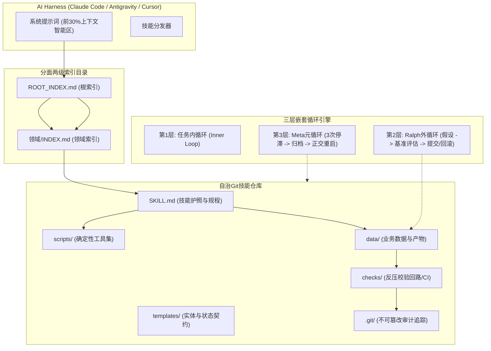

# Skill-First & Loop Engine (基于Git的智能体记忆与循环引擎)

[](LICENSE)
[](https://www.python.org/)
[](https://git-scm.com/)
[](#为什么基于git的技能优于传统rag)

> **专为AI智能体设计的Git原生记忆架构与多层自治循环引擎 (Loop Engine)。**  
> 彻底替代脆弱的RAG向量数据库，通过版本控制、反压校验及确定性文件流管理智能体长期记忆。

[English](README.md) | [Русский](README.ru.md) | [中文](README.zh.md)

---

## 理论来源与方法论背景

本项目完整实现了 **康斯坦丁·克雷斯特尼科夫 (Konstantin Krestnikov)** 在其开创性技术报告中所提出的系统架构：  
**[《基于Git的技能：AI智能体的新记忆》(YouTube演讲回放)](https://www.youtube.com/watch?v=a-NIeMB-Hj8)**。

相比于在生产环境中容易崩溃的复杂多智能体图框架（如LangGraph、AutoGen），本项目采用 **AI Harness（智能体马甲/轻量套件）** 结合 **自治Git技能仓库** 的极简高可用方案。智能体仅配备最基础的操作系统底层工具（文件读写、Bash终端、Grep搜索及子智能体调用）。

---

## 为什么基于Git的技能优于传统RAG

| 比较维度 | 传统RAG (向量数据库) | Skill-First架构 (Git技能仓库) |
| :--- | :--- | :--- |
| **检索机制** | 概率性计算（余弦向量相似度） | 确定性定位（树状目录、`grep`、精准模式） |
| **Token经济** | 每次提问均倾倒海量非结构化文本 | 两阶段加载：1行提示词触发 -> 仅在激活时读取全文 |
| **版本溯源与审计** | 缺失；黑盒Embedding，无时序记录 | 绝对不可篡改的提交历史（`git log`、diff、blame） |
| **执行能力** | 静态纯文本；消耗Token进行机械性计算 | 可执行本地脚本（`scripts/`）直接承担繁重计算 |
| **幻觉防御** | 无法在数据层实施强约束 | 反压校验回路（`checks/` / CI）强行拦截非法状态提交 |
| **多端多Agent协作** | 依赖复杂中心化数据库同步 | 借助Git原生分布式机制，智能体自动解决合并冲突 |

---

## 核心系统架构



---

## 五大运行法则

### 规则 1. 技能解剖学 (Skill Anatomy)
每个技能均为独立的自治Git仓库：
- `SKILL.md`：包含YAML元数据（1-2句供主索引调用）与完整执行规程。
- `scripts/`：Python/Bash确定性脚本，无需消耗大模型Token即可完成数据提取与清洗。
- `templates/` 与 `data/`：严格实体模板与持久化工作数据，通过 `grep` 或局部工具按需提取。
- `checks/`：反压校验脚本，提交前严格验证语法与数据合规性。

### 规则 2. 严格Git事务协议与反压验证
所有涉及状态变更的操作必须经过完整的4阶段事务流：
1. **入口同步 (Ingress)**：运行 `git pull` 或 `git status`，自动解决无损合并冲突。
2. **执行作业**：对本地代码或数据进行最小增量变更。
3. **反压验证 (Backpressure)**：运行 `checks/` 中的检查脚本。若返回非零退出码，严禁提交。
4. **出口提交 (Egress)**：原子级 `git add`，提交规范的Commit日志，并执行 `git push`。

### 规则 3. 自动化技能孵化与生命周期策展
- **5步触发器法则**：当探索新任务需要连续进行5次以上工具调用且形成闭环时，自动沉淀为新技能骨架。
- **基于反馈的持续校准**：用户的每一次纠错或边界反馈，智能体直接写回 `SKILL.md`，杜绝重复犯错。
- **每周策展人审计**：合并功能重叠的琐碎技能；超过30天未使用的技能压缩描述；超过90天未使用的技能归档至 `archive/`。

### 规则 4. 上下文智能区 (前30%) 与多层循环工程
- **前30%智能区保护**：上下文超出30-40%后推理能力断崖式下跌；严禁将大文件整体读入主对话。
- **Ralph外循环**：通过磁盘上的 `STATE.md` 记录状态，单步仅验证一个假设，指标提升时提交，发生倒退时立即执行 `git reset --hard HEAD` 干净回滚。
- **Meta元循环 (防死锁)**：当连续3次迭代停滞不前时，强制将当前进展推入 `archive/attempt_N/`，彻底重置基线，并在正交维度上另辟蹊径重新研发。

### 规则 5. 分面目录与两拍导航机制
- 当技能数量超过50个时，严格采用2级目录结构：`领域/技能`。
- **第1拍**：依据 `ROOT_INDEX.md` 定位领域，加载该领域的 `INDEX.md`（仅1次文件读取）。
- **第2拍**：通过相对路径直达激活 `SKILL.md`。若领域模糊，执行 `grep -rn "关键词" */INDEX.md` 毫秒级兜底。

---

## 仓库完整内容列表

```text
skill-first-engine/
|-- SKILL.md                 # 英文标准技能定义 (主入口)
|-- SKILL.ru.md              # 俄语版本技能定义
|-- SKILL.zh.md              # 中文版本技能定义
|-- scripts/
|   |-- build_index.py       # 分面目录构建器与两级索引生成器
|   |-- git_skill_sync.py    # Git事务同步与反压控制脚本
|   |-- curate_skills.py     # 记忆卫生审计器 (修剪与整合工具)
|   |-- eval_harness.py      # 快速诊断基准 (harness-bench-fast 与 agentskills.io)
|   `-- loop_runner.py       # 自动化 Ralph 循环 / AutoResearch 与 Meta 死锁控制器
|-- templates/
|   |-- SKILL_TEMPLATE.md    # 技能模板 (EN / RU / ZH)
|   |-- STATE_TEMPLATE.md    # Ralph循环状态模板 (EN / RU / ZH)
|   `-- CHECK_TEMPLATE.py    # 反压验证器编写模板
|-- checks/
|   `-- validate_skill.py    # 技能结构与规范反压校验器
|-- references/
|   `-- krestnikov_method.md # 克雷斯特尼科夫演讲理论精要 (EN / RU / ZH)
|-- LICENSE                  # MIT开源许可协议
`-- README.md                # 综合文档 (支持中英俄导航)
```

---

## 快速上手指令

### 1. 验证目标技能目录结构
```bash
python checks/validate_skill.py path/to/skill
```

### 2. 执行Git事务同步 (入口 -> 反压验证 -> 出口提交)
```bash
python scripts/git_skill_sync.py --skill-dir path/to/skill --action full -m "feat(data): 更新实体记录"
```

### 3. 生成两级分面目录索引
```bash
# 查看技能自动分类方案 (Dry-run)
python scripts/build_index.py /path/to/skills --classify

# 生成根索引 ROOT_INDEX.md 与领域 INDEX.md
python scripts/build_index.py /path/to/skills --index

# 物理迁移扁平目录至6大领域结构
python scripts/build_index.py /path/to/skills --migrate --index
```

### 4. 运行Ralph外循环单步迭代
```bash
python scripts/loop_runner.py \
  --work-dir /path/to/project \
  --hypothesis "添加索引以优化检索性能" \
  --test-cmd "pytest tests/benchmarks" \
  --new-metric "142 ops/sec" \
  --direction higher
```

### 5. 运行快速诊断基准 (Harness-Bench-Fast)
```bash
# 诊断单个技能或整个技能仓库
python scripts/eval_harness.py path/to/skills
```

---

## 演讲视频精彩时间戳

- [[04:19]](https://www.youtube.com/watch?v=a-NIeMB-Hj8&t=259) 多智能体复杂图框架的破产与脚手架的消亡。
- [[08:11]](https://www.youtube.com/watch?v=a-NIeMB-Hj8&t=491) Harness（马甲）理念：依赖操作系统底层基础工具集。
- [[10:22]](https://www.youtube.com/watch?v=a-NIeMB-Hj8&t=622) 上下文容量墙：30-40个工具是智能体承载极限。
- [[21:29]](https://www.youtube.com/watch?v=a-NIeMB-Hj8&t=1289) 两阶段按需加载：极简提示词描述 vs 运行时完整指令。
- [[24:20]](https://www.youtube.com/watch?v=a-NIeMB-Hj8&t=1460) 技能 + 数据 + Git = 智能体进化型新记忆。
- [[27:06]](https://www.youtube.com/watch?v=a-NIeMB-Hj8&t=1626) 反压机制 (Backpressure)：拦截智能体胡思乱想与数据破坏。
- [[40:36]](https://www.youtube.com/watch?v=a-NIeMB-Hj8&t=2436) 自我进化、5步触发规则与技能策展人模式。
- [[45:01]](https://www.youtube.com/watch?v=a-NIeMB-Hj8&t=2701) 前30%智能区与Ralph外循环迭代机制。
- [[45:32]](https://www.youtube.com/watch?v=a-NIeMB-Hj8&t=2732) Karpathy死锁效应与Meta循环正交重启突破。

---

## 开源许可

MIT License. Copyright (c) 2026 MakeHorizont.
