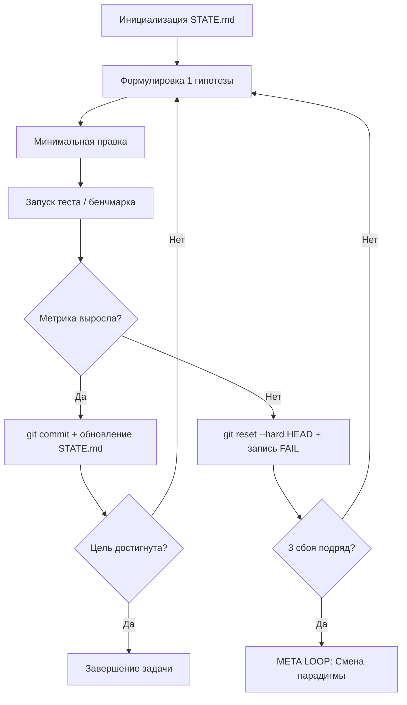

# АРХИТЕКТУРА SKILL-FIRST И ПАМЯТЬ АГЕНТОВ НА БАЗЕ GIT

Методологическое руководство на базе доклада Константина Крестникова ("Скиллы на базе git - новая память AI-агентов. Мой опыт", https://www.youtube.com/watch?v=a-NIeMB-Hj8).

---

## 1. ПРЕДЕЛ ТРАДИЦИОННОГО RAG И ПРИЧИНЫ ПЕРЕХОДА К GIT-СКИЛЛАМ

Классический подход к долгосрочной памяти AI-агентов через векторные базы данных (RAG / Vector DB) страдает рядом фундаментальных дефектов:

1. Стохастический поиск вместо детерминированного:
   Векторная близость (cosine similarity) выдает куски текста с высокой семантической похожестью, но без гарантии логической полноты или актуальности. Агент часто получает устаревшие или нерелевантные фрагменты.

2. Отсутствие истории изменений и версионирования:
   Векторная база не дает ответа на вопросы: когда изменилось правило, кто его обновил и почему был отменен предыдущий регламент.

3. Невозможность исполнения:
   Векторные документы пассивны. Они требуют от LLM тратить токены на чтение, разбор и интерпретацию даже примитивных алгоритмов.

---

## 2. АРХИТЕКТУРА SKILL-FIRST: РЕПОЗИТОРИЙ КАК ЕДИНИЦА ПАМЯТИ

В парадигме Skill-First каждый навык - это полноценный изолированный Git-репозиторий:

```text
+-------------------------------------------------------------+
|                       GIT REPOSITORY                        |
|                                                             |
|  [SKILL.md]     -> Паспорт, триггеры и правила поведения   |
|  [scripts/]     -> Исполняемые утилиты (экономия токенов)   |
|  [data/]        -> Фактическое состояние и сущности         |
|  [templates/]   -> Строгие схемы и прототипы               |
|  [checks/]      -> Обратное давление (Backpressure / CI)   |
|  [.git/]        -> Неизменяемая хроника и версионирование   |
+-------------------------------------------------------------+
```

### Ключевые преимущества:
- Точный доступ: модель выбирает нужные файлы через стандартные инструменты файловой системы (`grep`, `find`, `read_file`), загружая в память только целевой срез данных.
- Детерминированные инструменты: рутинные операции перенесены в скрипты (Python/Bash), освобождая внимание LLM для высокоуровневой логики.
- Автоматический аудит: Git фиксирует каждый шаг, автора изменений и причину коммита.

---

## 3. ЭКОНОМИКА КОНТЕКСТА И СМАРТ-ЗОНА (30%)

Исследования показывают, что качество рассуждений LLM деградирует по нелинейной кривой по мере заполнения контекстного окна:

- **0% - 30% окна (Смарт-зона)**: максимальная глубина внимания, точное следование системным инструкциям, минимальный уровень галлюцинаций.
- **30% - 70% окна**: постепенное размывание внимания, пропуск граничных условий.
- **70%+ окна**: критическая деградация, сбои при генерации сложных структур.

### Принцип фильтрации:
Запрещено читать массивные дампы данных в основной диалог. Сбор фактов производится через вспомогательные скрипты или изолированных субагентов, возвращающих краткие сводки.

---

## 4. ВНЕШНИЙ ЦИКЛ (RALPH LOOP) И АНТИ-СХЛАПЫВАНИЕ (META LOOP)

Для решения многочасовых инженерных задач используется двухуровневая петля управления:

### 4.1. Внешний цикл (Ralph Loop)
Агент хранит состояние не в памяти контекста, а на диске в файле `STATE.md`:



### 4.2. Мета-цикл (Meta Loop)
Когда оптимизация упирается в локальный максимум (3 неудачные попытки подряд):
- Старый подход объявляется исчерпанным;
- Все попытки упаковываются в архив;
- Выполняется возврат к базовому состоянию и переход на принципиально иную архитектуру.
